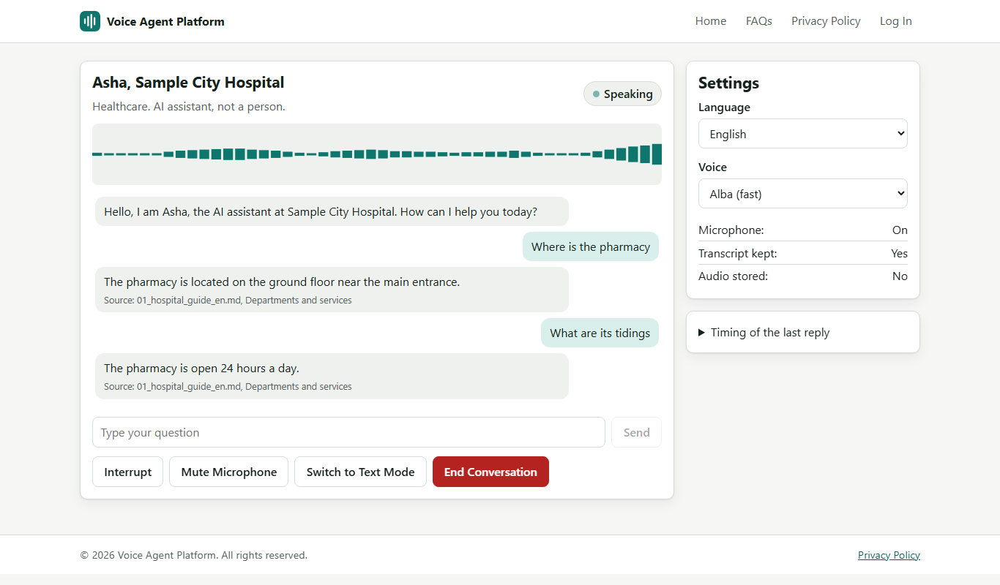

# Voice Agent Platform

A real-time AI voice agent that runs in a web page. Open the site, pick an industry and a language, press Start Conversation and talk. It is free, open source and self-hosted, with no phone line and no paid API. Speech, language model and knowledge search all run on your own computer.

English, Hindi and Bengali. 16 industry agents. Healthcare is the full reference.



## What it does

- Natural talk in the browser, with live words on screen
- Barge-in: talk over the agent and it stops at once
- Answers come only from your documents, with the source shown
- If the answer is not there, it says so and offers a person
- Emergencies and restricted topics are caught by plain code before the model sees them
- PDF, DOCX, TXT, MD, CSV, JSON, web addresses and FAQs as knowledge
- Admin pages for agents, knowledge, conversations, escalations, latency, users, audit log and system
- No audio is ever stored

## Measured on a laptop with 16 GB of memory and no GPU

| Measure | Result |
| --- | --- |
| First spoken reply, typical (p50) | About 2 seconds, after 0.45 seconds of silence |
| First spoken reply, slow (p95) | 2.8 to 3.3 seconds |
| Callers at one time | 2 |
| Word errors on human speech | English 12.5%, Hindi 10.1%, Bengali 3.1% (may be too good, see below) |
| Evaluation tests, 16 agents | 55 of 55 |
| Models on disk | About 1.3 GB |

## What has not been proved

Please read this part.

1. **No person has listened to the voices.** Clarity was measured by a recogniser, not by people.
2. **No real microphone or real room.** Tests used recordings played through a fake microphone device.
3. **Bengali score may be too good.** The recogniser may have trained on some test clips. Its publisher reports 14.4% word errors.
4. **Docker images were not built.** Docker would not start on the test laptop.
5. **Sample facts are invented.** Every organisation is marked Sample. Replace them with your own.
6. **Not certified.** It is not cleared for real patient, bank or legal data.
7. **More than a few callers is calculated, not measured.** See [cost and capacity](docs/12_COST_ANALYSIS.md).

## Quick start

Needs Python 3.12 and Bun or Node. About 3 GB of disk and 3 GB of free memory.

```bash
python -m venv .venv
.venv/Scripts/python -m pip install -r requirements.txt
.venv/Scripts/python scripts/fetch_models.py --profile cpu
cd frontend && bun install && bun run build && cd ..
cp .env.example .env
```

Set your own owner Email ID and password in `.env`, then start:

```bash
.venv/Scripts/python scripts/serve.py
```

Open http://localhost:8000.

Full steps, including a free public link: [deployment guide](docs/11_DEPLOYMENT.md).

## Documents

| Document | About |
| --- | --- |
| [01 Global research](docs/01_GLOBAL_RESEARCH.md) | What was tested and why |
| [02 GitHub audit](docs/02_GITHUB_AUDIT.md) | Repositories and models |
| [03 Free tech stack](docs/03_FREE_TECH_STACK.md) | The stack, hardware and models |
| [04 Licence audit](docs/04_LICENSE_AUDIT.md) | Read this before selling it |
| [05 Architecture](docs/05_ARCHITECTURE.md) | How it fits together |
| [06 Voice pipeline](docs/06_VOICE_PIPELINE.md) | Audio, turns, interruption |
| [07 Agent builder](docs/07_AGENT_BUILDER.md) | Making an agent |
| [08 Knowledge](docs/08_RAG.md) | Retrieval |
| [09 Languages](docs/09_MULTILINGUAL.md) | Evidence by language |
| [10 Security](docs/10_SECURITY.md) | Controls and limits |
| [11 Deployment](docs/11_DEPLOYMENT.md) | Local, public, Docker |
| [12 Cost and capacity](docs/12_COST_ANALYSIS.md) | 1 to 10,000 callers |
| [13 Performance](docs/13_PERFORMANCE.md) | All measurements |
| [14 Test report](docs/14_TEST_REPORT.md) | Results and open defects |
| [15 Operations](docs/15_OPERATIONS.md) | Running it |
| [Voice quality](docs/VOICE_QUALITY_REPORT.md) | Voice by voice |
| [API](docs/API.md) | Routes and the voice socket |
| [Troubleshooting](docs/TROUBLESHOOTING.md) | Common faults |
| [Privacy policy template](docs/PRIVACY_POLICY.md) | To adapt |

## Licence

Our source code is Apache-2.0. **Some run-time packages are GPL-3.0 and some models carry share-alike or other terms.** See [Third party notices](THIRD_PARTY_NOTICES.md) and the [licence audit](docs/04_LICENSE_AUDIT.md). This is not legal advice.
